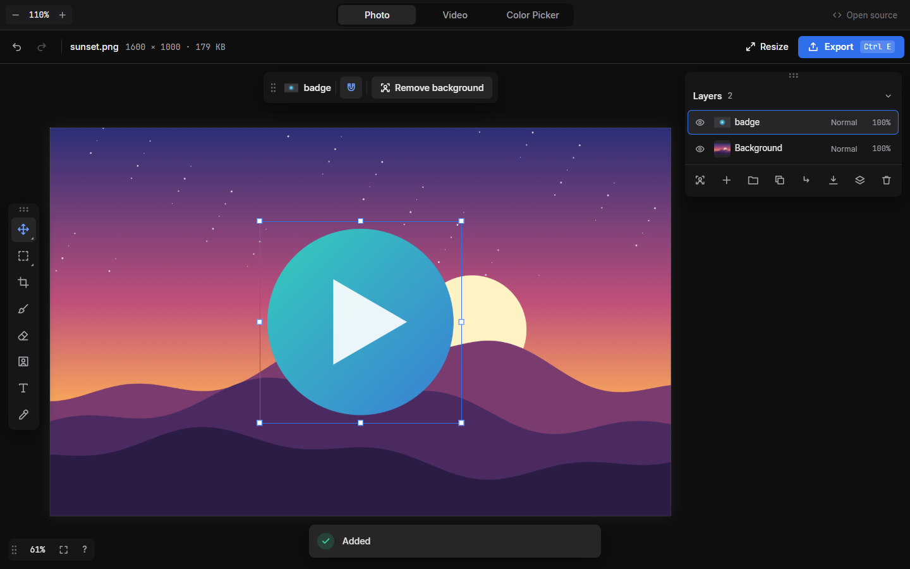
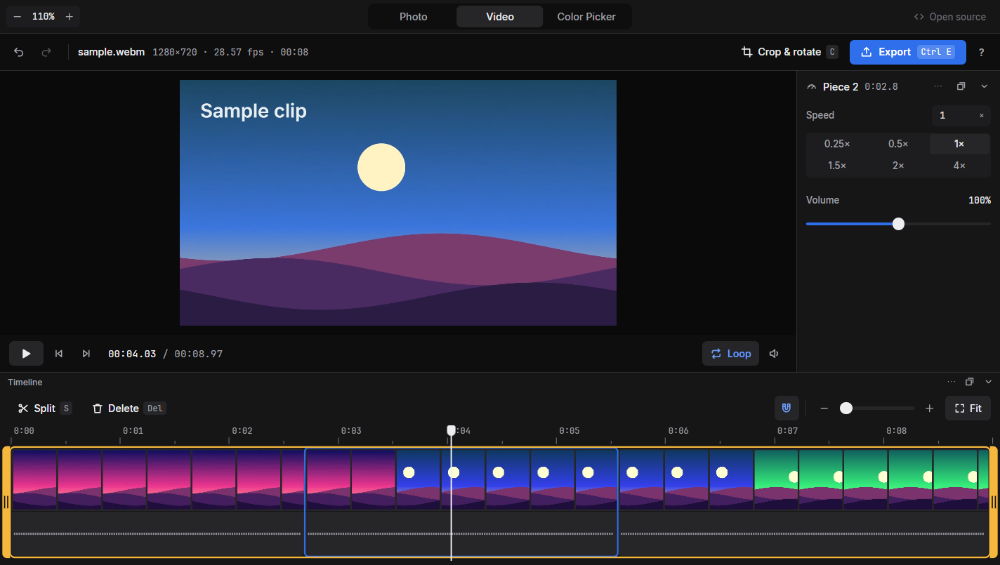
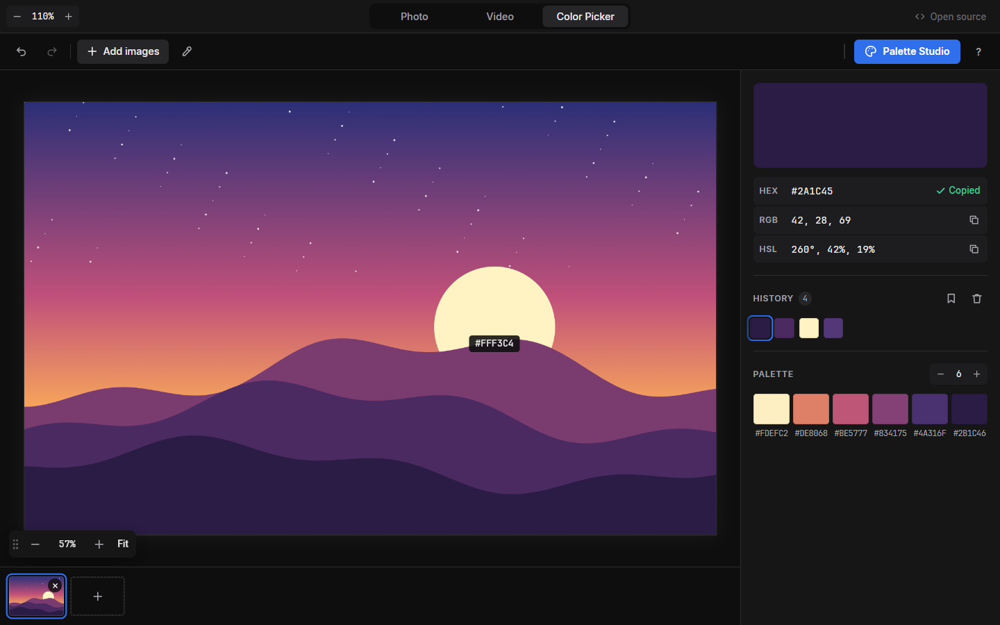

<div align="center">

# QuickCut

**Photo, video and colour tools that run entirely in your browser.**
Nothing is uploaded. No account. Works offline once loaded.

[Live demo](https://quickcut.cloud3dworks.art) · MIT OR Apache-2.0

  

</div>

## What it is

| | |
|---|---|
| **Photo** | Layers, groups, masks, 27 blend modes, smart layers, re-editable crop, selections, text, AI background remover (Fast, High detail, Hair & fur; on the GPU or the CPU) |
| **Video** | Split, delete, speed (up to 100x, pitch kept), volume, crop and rotate; Instant (lossless) and Exact export |
| **Color Picker** | Pick from images or the screen, zoom to the pixel, palettes, history |
| **Projects** | Save and open `.qcut` files for Photo and Video; recent files reopen with their layers and edits |
| **Files** | Drop any image, video or `.qcut` anywhere: it opens in the tool it belongs to |

A static site: HTML, JavaScript and a few WebAssembly modules. No build step, no server code.

## Run it

```sh
python -m http.server -d app 8080     # or any static server
```

Open <http://localhost:8080>. Use `localhost` or HTTPS: the service worker, WebCodecs and the
file APIs need a secure context. Chrome or Edge are the best-supported browsers; WebGPU makes the
background remover faster.

## Background remover models

The models are large and are not in git. Download and prepare them once:

```sh
pip install onnx==1.23.2 onnxruntime==1.23.2 onnxconverter-common==1.16.0 numpy
python app/models/fetch.py
```

It fetches the pinned upstream files, checks their SHA-256 and writes them to `app/models/` in parts.
See [app/models/README.md](app/models/README.md). Everything else works without them.

## Self-host

Copy `app/` to any static host (without `_test/`), served over HTTPS. Serve the `app/models/` parts
as static files too. Send `Cross-Origin-Opener-Policy: same-origin` and
`Cross-Origin-Embedder-Policy: credentialless` with the pages so the background remover can use
several CPU threads (without them it runs on one). After changing a site file, regenerate the service worker's file list:

```sh
python tools/gen-sw-manifest.py
```

## Rebuild the WebAssembly

Needs Rust with the `wasm32-unknown-unknown` target, `wasm-bindgen-cli` 0.2.129 and binaryen's `wasm-opt`.

```sh
QC_PKG_OUT=../app/video/pkg qc-wasm/build.sh   # Video: probe, lossless cut, mux, speed
qcut-wasm/build.sh                             # project-file codec -> app/shared/qcut-codec.wasm
```

## Tests

Start the static server, open the app, and in the console run for example
`(await import("/_test/smarttest.js")).run()`. The suites are in `app/_test/`;
`app/_test/qcut/index.html` runs the project-format tests by itself, and
`node app/_test/blendtest.mjs` checks the blend maths. A few tests need your own media files
(see the header of each test).

## Credits

- [PhotoCraft](https://github.com/storytold) and [FilmCraft](https://github.com/storytold), with
  [craft-libs](https://github.com/storytold/craft-libs): blend modes, MP4/MKV muxing and audio time-stretching come from their code.
- [BiRefNet](https://github.com/ZhengPeng7/BiRefNet): background removal model.
- [ONNX Runtime Web](https://github.com/microsoft/onnxruntime): runs the model in the browser.
- Inter and JetBrains Mono fonts (SIL OFL).

## Licence

MIT OR Apache-2.0, at your option: [LICENSE-MIT](LICENSE-MIT), [LICENSE-APACHE](LICENSE-APACHE).
Third-party notices: [NOTICE](NOTICE).
